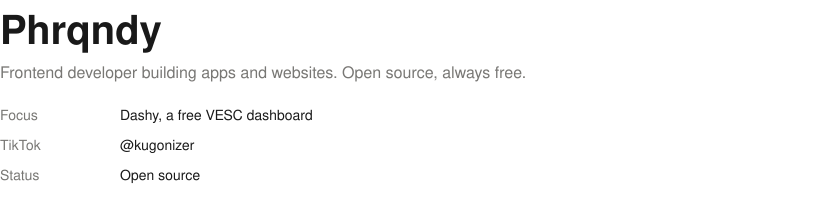
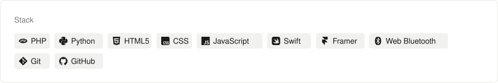
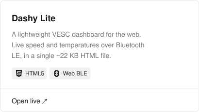
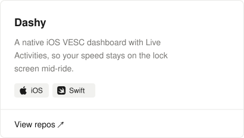

<picture>
  <source media="(prefers-color-scheme: dark)" srcset="assets/header-dark.svg">
  
</picture>

<picture>
  <source media="(prefers-color-scheme: dark)" srcset="assets/line-dark.svg">
  
</picture>

<picture>
  <source media="(prefers-color-scheme: dark)" srcset="assets/about-dark.svg">
  
</picture>

<picture>
  <source media="(prefers-color-scheme: dark)" srcset="assets/stack-dark.svg">
  
</picture>

<a href="https://dashy.kugonizer.workers.dev/"><picture>
  <source media="(prefers-color-scheme: dark)" srcset="assets/dashy-lite-dark.svg">
  
</picture></a>
<a href="https://github.com/Phrqndy?tab=repositories"><picture>
  <source media="(prefers-color-scheme: dark)" srcset="assets/dashy-dark.svg">
  
</picture></a>
