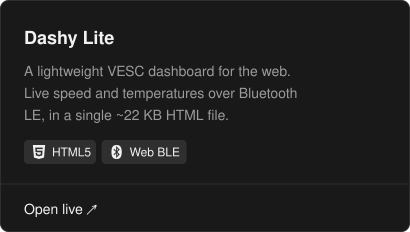
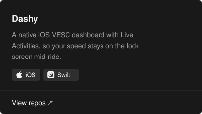

 

**Developer · Designer · Builder**

Thoughtful interfaces. Powerful systems. Beautiful simplicity.

 

[**Explore Dashy Lite ↗**](https://dashy.kugonizer.workers.dev/) &nbsp; / &nbsp; [**Selected work ↗**](https://github.com/Phrqndy?tab=repositories) &nbsp; / &nbsp; [**Follow ↗**](https://github.com/Phrqndy?tab=followers)

  

---

### 01 — About

I build thoughtful digital experiences for the **web and iOS** — where product design meets practical engineering.

My work spans **Swift**, **PHP**, modern frontend development, and **VESC-connected software**. I care about precise details, responsive interfaces, and products that feel effortless to use.

### 02 — Selected work

<table>
<tr>
<td width="50%" valign="top">

**Dashy Lite**

A lightweight VESC dashboard for the web.

[Launch application ↗](https://dashy.kugonizer.workers.dev/)

</td>
<td width="50%" valign="top">

**Dashy for iOS**

A native VESC experience designed for iPhone.

[Explore repositories ↗](https://github.com/Phrqndy?tab=repositories)

</td>
</tr>
</table>

### 03 — Toolkit

`Swift` · `PHP` · `Python` · `JavaScript` · `HTML` · `CSS` · `Web Bluetooth` · `Git`

### 04 — Philosophy

> Make it useful. Make it intuitive. Make every detail count.

The best engineering makes complexity invisible. I aim to create products that feel natural from the first interaction.

 

---

DESIGNED WITH INTENTION &nbsp;·&nbsp; PHRQNDY &nbsp;·&nbsp; 2026

